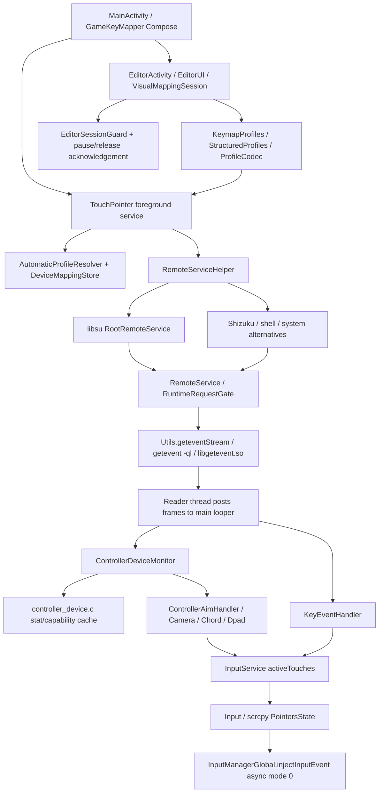

# XtMapper source audit — MythicMapper foundation

Baseline: `rickallauigan/XtMapper` dev `603b11dd9f919fd447dee25a2640dad03932af97`.
Destination: https://github.com/rickallauigan/mythicmapper (public, separately cloned).
Original repository/worktree has not been modified. Full reachable dev history is retained;
other upstream branches are available through the read-only `xtmapper` remote, not mirrored or deleted.

## Evidence and coverage

`source-inventory.json` lists every tracked baseline file with content hashes, declarations,
imports and license-header evidence. Whole-tree scanning is distinct from detailed review.
The runtime files below were read/traced; peripheral legacy UI/translation files received
structural inspection rather than an exhaustive line-by-line correctness review.
No claim of a complete legal clearance or physical gameplay retest is made.

## Actual dependency map

Controller capture is an external Android `getevent` text stream, NOT the native mouse
reader. `getevent.c` interposes `setvbuf` behavior through LD_PRELOAD for flushing.
`RemoteService.start_getevent` splits lines, captures a runtime generation and posts
per-line work onto the main looper. `handleInputFrame` rejects stale owners before dispatch.
The dedicated JNI `mouse_read.c` reader handles REL mouse traffic and grabs only its
validated mouse node. It does not read the G8 controller stream.

## Component decisions

Paths below are relative to `app/src/main/java/xtr/keymapper/` unless prefixed otherwise.

| Component / implementation evidence | Decision | Rationale and risk |
|---|---|---|
| `devices/InputDeviceDiscovery.kt:connected`; `DeviceModels.kt:logicalDevices`, `InterfaceEvidence`; `DeviceMappingStore.kt` | REUSE + REFACTOR | Public Android sources, descriptors and VID/PID support stable HID groups. No exclusive G8 allowlist. Never trust transient Android id for persisted identity. |
| `controller/ControllerDeviceMonitor.java:NodeDiscovery.get`, `scan`, `event`; `app/src/main/cpp/controller_device.c:probe`, `identity` | REUSE + REFACTOR | Rejects touchscreen/sensor nodes, validates RX/RY ranges, caches capability probes by inode/rdev; stat polling every 250 ms. Generic capability recognition can admit other gamepads. Main-looper scan/locking can delay dispatch; device ids must be corroborated before strict filtering. |
| `controller/ControllerBindings.java:canonical`, `capture`; `ControllerDpad.java:axis` | REUSE | Linux aliases, digital shoulders/triggers and hat reversals preserve press/release identity. ABS_Z/RZ intentionally do not duplicate digital triggers. |
| `ControllerDeviceMonitor.Device.axes`, `.button`, `.reset` | REUSE | RX/RY updates coalesce at SYN_REPORT; button flushes pending axes. SYN_DROPPED invalidates cached node and resets touches; one controller owns profile. ABS_X/Y deliberately remain native to MLBB. |
| `controller/ControllerAimHandler.java:normalize`, `vector`, `trigger`, `axes`, `reset` | REUSE; candidate pure math Rust boundary | Independent held skill pointers (50+index), latest held skill owns right stick, edge-fitting preserves direction. Per-move float array; port only after baseline, parity and device gates. |
| `ControllerCameraHandler.java:axes`, `suspend`, `tick` | REUSE | 16 ms scheduled camera, 50 ms dt cap; skill priority releases camera pointer 58. Scheduling differs from direct skill path. |
| `ControllerChordHandler.java:event`, `reset` | REUSE engine / exclude automatic sequences | Modifier-first ownership persists until trigger UP. Pointer range starts max(59, fixed-key count); parser caps matter. Single physical press maps to single action. |
| `server/RootRemoteService.java:onBind`; `RemoteServiceHelper.java:getInstance`; `RemoteServiceShell.java:main` | REFACTOR | RootService already works; Shizuku shares mapping runtime. Shell startup changes SELinux and low-RAM overlay settings: REMOVE those commands. Keep permission requests explicit through Android settings. |
| `server/InputService.java:injectEvent`, `stop`, `reloadKeymap`, `pauseResumeKeymap` | REUSE + REFACTOR | Tracks held ids, ignores duplicate DOWN/unmatched UP/late MOVE; ten-touch cap; producers stop and all touches release on switch. Extract submission interface and error reporting; logical state currently assumes injection success. |
| `server/Input.java:injectTouch`, `injectInputEvent`; `app/src/main/java/com/genymobile/scrcpy/{Point,Pointer,PointersState}.java` | REUSE backend | MotionEvent multi-pointer actions/indexes, pressure and recycling already implemented; reflective InputManagerGlobal on recent Android, async mode 0. Method return ignored; reflection setup failures only logged. Unexpected process termination cleanup not proven. |
| `server/RuntimeRequestGate.java`; `RemoteService.java:startServer`, `stopRuntime`, `handleInputFrame`; `TouchPointer.kt:connectRemoteService` | REUSE | Generation and ownership barriers prevent stale queued frames/callbacks touching successor. New favorite switching must use this path; do not inject directly from UI. Crash handler launches UI then exits without explicit stop; INVESTIGATE. |
| `app/src/main/cpp/mouse_read.c`; `server/event/MouseEventHandler.java`; `mouse/*`, `dpad/*`, `swipekey/*` | Retain compatibility code; outside new MVP UI | Joined reader, bounded poll and disconnect cancellation have tests. Do not remove shared dependencies prematurely. Mouse/keyboard, swipe sequences and non-MLBB modes are not MythicMapper features. |
| `app/src/main/cpp/{evdev_common.cpp,touchpad_direct.cpp,touchpad_relative.cpp,mouse_cursor.cpp}` | REMOVE from MVP activation; retain pending dependency isolation | Existing uinput is mouse/touchpad support, NOT proven multitouch touch backend. Relative loop never checks running, direct stop joins even when no reader, capability helpers lack reliable error checks; directory handle not closed. Do not route G8 through these features. |
| `editor/{EditorActivity.java,EditorUI.kt,VisualControllerEditor.kt,VisualMappingSession.kt,EditorSessionGuard.kt}` | REUSE | Compose controller selection, physical-key capture, draggable targets, aim tuning, optimistic save and pause lease already exist. General-purpose advanced controls need scope filtering. |
| `editor/{CoordinateCaptureSession.kt,CoordinateCaptureUi.kt,CapturedTarget.kt,CaptureInterruptionGuard.kt}` | REUSE | Separate measured target store; full-plane transforms; bounded traces/undo; interruptions close editor. Never apply a guessed cutout offset. Target library excluded from legacy ZIP. |
| `keymap/{KeymapProfiles.java,KeymapProfile.java,ProfileConfiguration.java,ProfileStorageTransactions.java,ProfileZipImporter.java}` | REUSE + REFACTOR | Checked import/rename and bounded no-extraction ZIP parser; Parcelable native runtime model. Names are current storage keys, not stable IDs; favorites require an additional ID registry or UUID-keyed namespace. |
| `structured/{ProfileDocument.kt,ProfileCodec.kt,StructuredProfiles.kt,StructuredProfileActivity.kt}` | REUSE | Version 1 JSON/YAML, strict keys/finite values/limits, no YAML objects/aliases, metadata/projection atomicity and optimistic locking. Extend schemas explicitly; reject unknown future versions without overwriting. |
| `profiles/{AutomaticProfileResolver.kt,ProfileSelector.java}`; `TouchPointer.kt:observeForeground` | REUSE + REFACTOR | Existing device-bound foreground selection and pause barrier; favorite choice must not immediately be undone by auto resolver. |
| `macro/*`; `keymap/KeymapProfile.java:loadMacros`; `server/event/KeyEventHandler.java:handleEvent` macro branch | REMOVE from MythicMapper activation | User-authored timed sequences/repeat features exceed one-action-per-input MVP and automation scope. Preserve historical sources; reject such profiles at MythicMapper boundary. |
| `ui/GameKeyMapper.kt`; `activity/MainActivity.java` | REFACTOR | Compose home and root permissions already exist. Add offline hero catalog/five slots/controller status here, reuse editor routes. Current UI supports all games/controllers; scope enforcement remains required. |
| `app/Android.mk`, `Application.mk`, `app/build.gradle`, root Gradle/settings/wrapper/hidden-api | REUSE | ndk-build seven native libs, Java 21, AGP 9.2.1, Compose plugin 2.4.0, API 37, target 34, NDK 28. No existing Rust. Keep original Java namespace for JNI; separate applicationId before installing. |
| `app/src/test/java/**`, `app/src/test/native/**`, `tools/**`, generator tests | REUSE | Robolectric lifecycle/ownership/aim/editor/storage suites; native ioctl/JNI mocks; Python immutable fixtures. Host success never proves gameplay. |
| `.github/workflows/validate-pr.yml`, `build-apk.yml`, `release-apk.yml`, `build-docs.yml`, `crowdin-action.yml` | REFACTOR | Validation exists but named Gameplay validation although host-only. Releases manual; no release dispatch authorized. Translation/docs workflows reference upstream services and require scope review. |
| Launcher images, cursor/key/dpad artwork and docs screenshots in inventory | INVESTIGATE | No individual provenance/license evidence found. Do not add GameSir/MLBB artwork; replace launcher with original vector before distribution and retain provenance review for other assets. |

## Historical evidence and bottlenecks

Read `docs/DEVLOG.md`, `docs/PROFILE-AIM.md`, `docs/coordinate-capture.md`,
`docs/phase1-anchor-followup.md`, `profiles/mlbb/samsung-s10e/{README.md,GAMESIR-G8.md}`.
History reports observed G8 mode `Sony Interactive Entertainment GameSir-G8`, USB
054c:0ce6; this is mode-specific metadata, not a universal G8 identity. Do not accept
a Sony id alone as G8 proof. Historical tuned v0.3 radius 80 addressed an observed
RT-to-Ultimate unintended cast; preserve every fixture byte. Original left stick stays
native. LT concurrency, rear-button programming and reconnect historical evidence
must not be generalized to a new APK/OS/HUD. Phase2 Quick Buy has no measured anchor;
never invent one or call a hero preset verified without evidence.

Likely costs requiring measurement: external text formatting/pipe buffering, regex
splits and per-frame Handler closures; main-looper work and 250 ms scan; synchronous
Binder callbacks; float[]/Point allocations; MotionEvent reflection and submission.
Capability-cache fix is already present: do not implement repeated-probe optimization again.
Reconnection discovery can run on first button/hat; pure analog-only first events wait
for polling. Camera cadence is distinct from skill dispatch. Backend result/EOF recovery
and crash cleanup remain risks. No measured physical latency or device CPU data yet.
